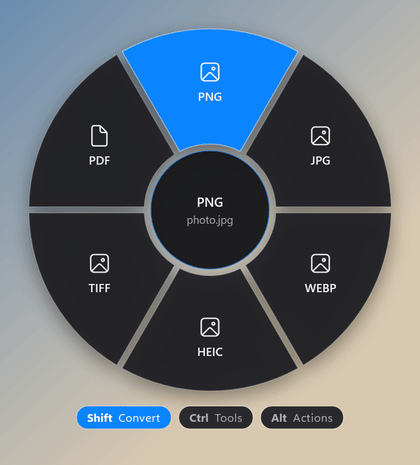
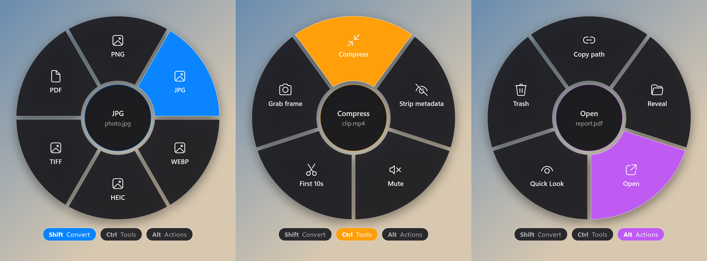

<div align="center">


# FanDrop برای ویندوز

**فایل رو بکش. یه کلید بزن. روی یه تیغه رهاش کن. تمام.**

یه بادبزن دایره‌ای که وسط drag کردن، دور نشانگر موس باز می‌شه و فایلی که دستته رو تبدیل، فشرده، کوتاه، زیپ یا هش می‌کنه — بدون این‌که حتی یه برنامه باز کنی.

[](https://github.com/sinasohrabi9444/FanDrop-Windows/actions/workflows/build.yml)
[](https://github.com/sinasohrabi9444/FanDrop-Windows/releases/latest)

[](LICENSE)

[English](README.md) · **فارسی** · [📚 آموزش‌ها](docs/fa/README.md)

<br>



</div>

---

<div dir="rtl">

## ✨ چرا FanDrop؟

- **بدون پنجره، بدون کلیک اضافه.** همه‌چیز توی همون dragی انجام می‌شه که داشتی می‌کردی.
- **فقط یه فایل exe حدود ۱۱۰ کیلوبایتی.** نصب لازم نداره و روی .NET Framework 4.8 که توی همه‌ی ویندوزهای ۱۰ و ۱۱ هست اجرا می‌شه.
- **سه حالت روی سه کلید:** تبدیل، ابزارها و کارهای فایل؛ تیغه‌ها بسته به نوع فایل عوض می‌شن.
- **چندتایی:** ۲۰ تا عکس رو بکش و روی `JPG` رها کن، ۲۰ تا JPG تحویل بگیر.
- **فایل‌های مجازی** که از مرورگر یا Outlook drag می‌شن هم پشتیبانی می‌شن.
- **پیش‌نمایش داخلی (Quick Look)** برای عکس، ویدیو، صدا، PDF و متن.

## 🎛️ سه حالت

<div align="center">

</div>

| کلید (وسط drag) | معادل مک | حالت | رنگ |
|---|---|---|---|
| <kbd>Shift</kbd> | ⇧ Shift | **Convert** — تبدیل فرمت | 🔵 آبی |
| <kbd>Ctrl</kbd> | ⌘ Command | **Tools** — ابزارها | 🟠 نارنجی |
| <kbd>Alt</kbd> | ⌃ Control | **Actions** — کارهای فایل | 🟣 بنفش |

## 🚀 شروع سریع

1. **[`FanDrop.exe` رو از آخرین Release دانلود کن](https://github.com/sinasohrabi9444/FanDrop-Windows/releases/latest).**
2. اجراش کن. آیکون بادبزن میاد توی system tray (کنار ساعت).
3. یه فایل رو توی Explorer شروع کن به drag کردن، **بعد** یکی از کلیدهای <kbd>Shift</kbd> / <kbd>Ctrl</kbd> / <kbd>Alt</kbd> رو نگه دار.
4. بادبزن دور نشانگر باز می‌شه. برو روی یکی از تیغه‌ها و موس رو ول کن.
5. یه نوتیفیکیشن میاد؛ روش کلیک کنی فایل خروجی توی Explorer نشون داده می‌شه.

خروجی‌ها می‌رن توی **`Downloads\FanDrop`**. برای اجرای خودکار با ویندوز: راست‌کلیک روی آیکون ← **Start with Windows**.

> [!TIP]
> کلید رو **بعد** از شروع drag بزن. کلیدی که *قبل* از شروع drag نگه داشته شده بود حساب نمی‌شه، تا با انتخاب چندتایی معمولی Explorer قاطی نشه. وسط کار می‌تونی کلید رو عوض کنی تا حالت عوض بشه.

## 🧰 همه‌ی گزینه‌ها

| نوع فایل | Convert (Shift) | Tools (Ctrl) |
|---|---|---|
| 🖼️ تصویر | PNG، JPG، WEBP، HEIC، TIFF، PDF | Resize 1280، Compress، Strip metadata، Rotate 90°، Grayscale |
| 🎬 ویدیو | MP4، MOV، GIF، WEBM، MP3 | Compress، Strip metadata، Mute، First 10s، Grab frame |
| 🎵 صدا | MP3، M4A، WAV، FLAC، OGG | Strip metadata، Normalize، First 30s، Mono، Compress |
| 📝 سند | TXT، RTF، HTML، DOCX | Copy text، Word count، ZIP |
| 📕 PDF | PNG، JPG (همه‌ی صفحه‌ها) | ZIP، Strip metadata* |
| 📦 بقیه / پوشه | ZIP، SHA-256 | ZIP، SHA-256 |

**Actions (Alt)** برای همه‌ی فایل‌ها: Copy path، Reveal (نشون دادن توی Explorer)، Open، Quick Look، Trash (سطل بازیافت).

## 📦 پیش‌نیازها

- **ffmpeg** برای ویدیو، صدا و WEBP: `winget install Gyan.FFmpeg`، یا `ffmpeg.exe` رو کنار `FanDrop.exe` بذار.
- **HEIC** از کدک‌های خود ویندوز استفاده می‌کنه: «HEIF Image Extensions» و «HEVC Video Extensions» از Microsoft Store.
- **اسناد:** اگه Microsoft Word یا LibreOffice نصب باشه، تبدیل با همون انجام می‌شه و فرمت‌بندی حفظ می‌شه. اگه نه، تبدیل داخلی متن و پاراگراف‌ها رو نگه می‌داره ولی فرمت‌بندی رو نه.
- PNG، JPG، TIFF، PDF، ZIP، SHA-256 و Actions به هیچ چیز اضافه‌ای نیاز ندارن.

\* Strip metadata برای PDF فقط با `exiftool` کار می‌کنه.

## 📚 آموزش‌ها

آموزش کامل و قدم‌به‌قدم توی پوشه‌ی [`docs/fa`](docs/fa/README.md):

| # | آموزش |
|---|---|
| ۱ | [نصب و اجرا](docs/fa/01-getting-started.md) |
| ۲ | [اولین drag: کار با بادبزن](docs/fa/02-using-the-fan.md) |
| ۳ | [مرجع کامل تیغه‌ها](docs/fa/03-reference.md) |
| ۴ | [نصب پیش‌نیازها (ffmpeg، HEIC، …)](docs/fa/04-requirements.md) |
| ۵ | [سناریوهای کاربردی و ترفندها](docs/fa/05-recipes.md) |
| ۶ | [عیب‌یابی](docs/fa/06-troubleshooting.md) |
| ۷ | [ساخت از سورس و توسعه](docs/fa/07-build-and-develop.md) |

## 🛠️ ساخت از سورس

```bat
git clone https://github.com/sinasohrabi9444/FanDrop-Windows.git
cd FanDrop-Windows
build.cmd
```

از کامپایلر C# داخل خود ویندوز استفاده می‌کنه و چیزی برای نصب لازم نداره.

## 📄 لایسنس

[MIT](LICENSE) © Sina Sohrabi

</div>
