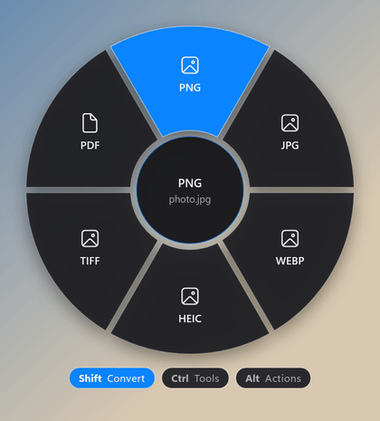
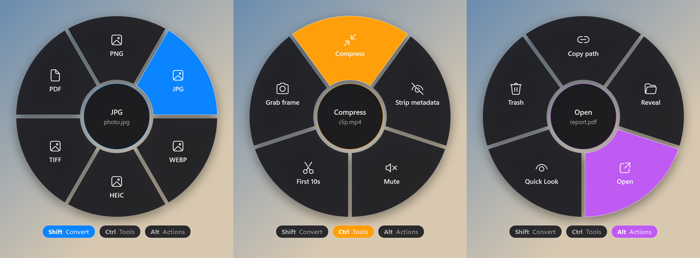

<div align="center">


# FanDrop for Windows

**Drag a file. Tap a key. Drop it on a blade. Done.**

A radial "drop fan" that pops up around your cursor mid-drag and converts, compresses, trims, zips or hashes the file you're holding — without opening a single app.

[](https://github.com/sinasohrabi9444/FanDrop-Windows/actions/workflows/build.yml)
[](https://github.com/sinasohrabi9444/FanDrop-Windows/releases/latest)


[](LICENSE)

**English** · [فارسی](README.fa.md) · [📚 Tutorials (Persian)](docs/fa/README.md)

<br>



</div>

---

## ✨ Why FanDrop?

- **Zero windows, zero clicks.** The whole job happens inside a drag you were already doing.
- **One tiny `.exe`** (~110 KB). No installer, no runtime to download — it runs on the .NET Framework 4.8 that already ships with every Windows 10/11.
- **Three modes on three keys** — Convert, Tools and Actions, each with blades tailored to the file type you're dragging.
- **Batch-friendly.** Drag 20 photos, drop on `JPG`, get 20 JPGs. Drag several files onto `ZIP`, get one `Archive.zip`.
- **Works with virtual files** dragged out of browsers and Outlook, not just Explorer.
- **Built-in Quick Look** for images, video, audio, PDF and text — something Windows never had.

## 🎛️ The three modes

<div align="center">

</div>

| Key (hold mid-drag) | Mode | Colour | What it does |
|---|---|---|---|
| <kbd>Shift</kbd> | **Convert** | 🔵 blue | Change the file format |
| <kbd>Ctrl</kbd> | **Tools** | 🟠 orange | Resize, compress, trim, strip metadata… |
| <kbd>Alt</kbd> | **Actions** | 🟣 purple | Copy path, reveal, open, preview, trash |

## 🚀 Quick start

1. **[Download `FanDrop.exe`](https://github.com/sinasohrabi9444/FanDrop-Windows/releases/latest)** from the latest release.
2. Run it. A fan icon appears in the system tray (next to the clock).
3. Start dragging any file in Explorer — **then** press and hold <kbd>Shift</kbd>, <kbd>Ctrl</kbd> or <kbd>Alt</kbd>.
4. The fan opens around your cursor. Move onto a blade and release the mouse.
5. A notification tells you it's done. Click it to see the result in Explorer.

Results land in **`Downloads\FanDrop`**. Right-click the tray icon → **Start with Windows** to keep FanDrop always ready.

> [!TIP]
> Press the key **after** the drag starts. A key you were already holding when the drag began is ignored, so normal <kbd>Ctrl</kbd>/<kbd>Shift</kbd> multi-select in Explorer never opens the fan by accident. You can switch keys mid-drag to switch modes.

## 🧰 Everything on the fan

| File type | Convert <kbd>Shift</kbd> | Tools <kbd>Ctrl</kbd> |
|---|---|---|
| 🖼️ **Image** | PNG · JPG · WEBP · HEIC · TIFF · PDF | Resize 1280 · Compress · Strip metadata · Rotate 90° · Grayscale |
| 🎬 **Video** | MP4 · MOV · GIF · WEBM · MP3 | Compress · Strip metadata · Mute · First 10s · Grab frame |
| 🎵 **Audio** | MP3 · M4A · WAV · FLAC · OGG | Strip metadata · Normalize · First 30s · Mono · Compress |
| 📝 **Document** | TXT · RTF · HTML · DOCX | Copy text · Word count · ZIP |
| 📕 **PDF** | PNG · JPG (every page) | ZIP · Strip metadata* |
| 📦 **Anything else / folder** | ZIP · SHA-256 | ZIP · SHA-256 |

**Actions** <kbd>Alt</kbd> work on every file: **Copy path** · **Reveal** in Explorer · **Open** · **Quick Look** · **Trash** (Recycle Bin).

<details>
<summary><b>Supported input extensions</b></summary>

- **Image:** png jpg jpeg jfif jpe gif bmp tif tiff webp heic heif avif ico
- **Video:** mp4 mov m4v mkv avi webm wmv flv mpg mpeg 3gp ts mts m2ts ogv
- **Audio:** mp3 m4a wav flac ogg oga opus aac wma aiff aif caf alac amr
- **Document:** doc docx rtf txt html htm odt md pages
- **PDF:** pdf

</details>

## 📦 Requirements

| Feature | Needs |
|---|---|
| PNG, JPG, TIFF, PDF, ZIP, SHA-256, all Actions | **Nothing** — built in |
| Video, audio, WEBP | **ffmpeg** — `winget install Gyan.FFmpeg`, or drop `ffmpeg.exe` next to `FanDrop.exe` |
| HEIC | *HEIF Image Extensions* + *HEVC Video Extensions* from the Microsoft Store |
| Documents with formatting | Microsoft Word **or** LibreOffice (optional — without them text and paragraphs are kept, formatting isn't) |
| PDF strip metadata* | `exiftool` on `PATH` |

## 🆚 Differences from the macOS version

- Keys: <kbd>⌘ Command</kbd> → <kbd>Ctrl</kbd> and <kbd>⌃ Control</kbd> → <kbd>Alt</kbd>.
- Windows has no Quick Look, so FanDrop ships its own preview window (image, video, audio, PDF, text). <kbd>Space</kbd>/<kbd>Esc</kbd> closes it, <kbd>←</kbd> <kbd>→</kbd> step through files.
- No Accessibility / Input Monitoring permission needed.
- Virtual files dragged from browsers / Outlook are supported (the equivalent of macOS file promises).

## 🛠️ Build from source

```bat
git clone https://github.com/sinasohrabi9444/FanDrop-Windows.git
cd FanDrop-Windows
build.cmd
```

That's it. `build.cmd` uses the C# compiler that ships inside Windows (`%WINDIR%\Microsoft.NET\Framework64\v4.0.30319\csc.exe`) — no Visual Studio, no SDK, no NuGet. It builds twice: once to draw the app icon in code, once to embed it.

### Developer hooks

```bat
:: run one action headless, no UI
FanDrop.exe --run Convert PNG "C:\path\photo.heic"

:: render the fan to a PNG (optional last arg = highlighted blade index)
FanDrop.exe --snapshot fan.png Tools "C:\path\clip.mp4" 0
```

| Environment variable | Effect |
|---|---|
| `FANDROP_OUT` | Output folder (default `Downloads\FanDrop`) |
| `FANDROP_DEBUG=1` | Verbose logging |
| `FANDROP_NO_OFFICE=1` | Don't use Word / LibreOffice for documents |

Logs live at `%TEMP%\fandrop.log` (tray menu → **Show log**).

### Project layout

```
src/
├── App.cs          entry point, tray icon, notifications, autostart, logging
├── DragWatcher.cs  low-level mouse hook: detects a drag + Shift/Ctrl/Alt
├── FanWindow.cs    the transparent radial fan overlay (WPF) and its animations
├── DropData.cs     reads real & virtual files out of the OLE drop
├── Model.cs        file kinds, modes and which blades each one gets
├── Actions.cs      Convert / Tools / Actions dispatch and output naming
├── Media.cs        image pipeline (WIC) + ffmpeg runner
├── Docs.cs         text extraction & document conversion (Word / LibreOffice / built-in)
├── WinRtImaging.cs HEIC encoding through WinRT
├── WinRtPdf.cs     PDF page rendering through WinRT
├── QuickLook.cs    the preview window
├── IconArt.cs      app & tray icon, drawn in code
└── Native.cs       Win32 P/Invoke
```

## 🤝 Contributing

Bug reports, ideas and PRs are welcome — see [CONTRIBUTING.md](CONTRIBUTING.md).

## 📄 License

[MIT](LICENSE) © Sina Sohrabi
