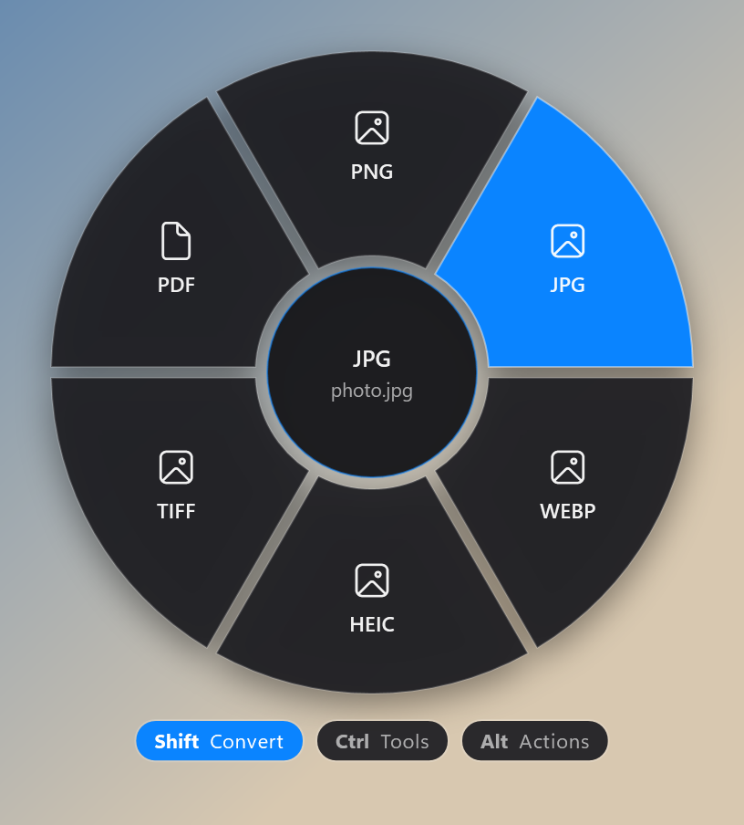
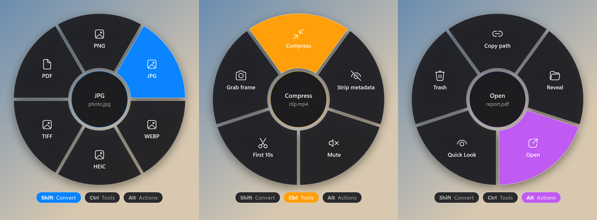

<div dir="rtl">

# ۲. اولین drag: کار با بادبزن

کل FanDrop همینه: **drag ← کلید ← رها کردن روی تیغه.**

## قدم‌به‌قدم

1. توی Explorer (یا دسکتاپ) یه عکس رو با کلیک چپ بگیر و **شروع کن به کشیدن**.
2. حالا که در حال کشیدنی، کلید <kbd>Shift</kbd> رو بزن و نگه دار.
3. یه بادبزن آبی دور نشانگر باز می‌شه، با تیغه‌های PNG، JPG، WEBP، HEIC، TIFF و PDF.
4. موس رو ببر روی تیغه‌ی **PNG** — رنگی می‌شه و اسمش وسط دایره نوشته می‌شه.
5. **کلیک رو ول کن.**
6. چند لحظه بعد نوتیفیکیشن میاد. روش کلیک کن تا فایل جدید توی Explorer نشون داده بشه.

<div align="center">

</div>

## سه کلید، سه حالت

| کلید | حالت | رنگ | برای چی |
|---|---|---|---|
| <kbd>Shift</kbd> | **Convert** | 🔵 | عوض کردن فرمت فایل |
| <kbd>Ctrl</kbd> | **Tools** | 🟠 | تغییر روی خود فایل: کوچیک کردن، فشرده‌سازی، بریدن، حذف متادیتا |
| <kbd>Alt</kbd> | **Actions** | 🟣 | کارهای فایل: کپی مسیر، نمایش، باز کردن، پیش‌نمایش، حذف |

پایین بادبزن سه تا «چیپ» هست که نشون می‌ده الان توی کدوم حالتی.
**وسط drag می‌تونی کلید رو عوض کنی**: مثلاً با Shift باز کردی، Ctrl رو بزن تا بره روی Tools.

<div align="center">

</div>

## ⚠️ مهم‌ترین نکته: ترتیب کلید و drag

کلید رو **بعد** از شروع drag بزن، نه قبلش.

چرا؟ توی Explorer، Ctrl و Shift برای انتخاب چندتایی فایل‌ها استفاده می‌شن. اگه FanDrop کلیدی رو که از قبل نگه داشته بودی حساب می‌کرد، هر بار که چند فایل انتخاب می‌کنی و می‌کشی بادبزن الکی باز می‌شد. برای همین:

- ✅ کلیک ← کشیدن ← **زدن کلید** ← بادبزن باز می‌شه
- ❌ نگه داشتن کلید ← کلیک ← کشیدن ← بادبزن باز **نمی‌شه** (تا وقتی کلید رو ول کنی و دوباره بزنی)

## لغو کردن

نمی‌خوای کاری انجام بشه؟ هر کدوم از این‌ها:

- موس رو ببر **وسط دایره** (روی اسم فایل) و ول کن.
- موس رو از بادبزن **ببر بیرون** و جای دیگه ول کن — drag معمولی ویندوز ادامه پیدا می‌کنه.
- <kbd>Esc</kbd> رو بزن (drag خود ویندوز لغو می‌شه).

## چند فایل با هم

چند فایل رو انتخاب کن و همه رو با هم بکش:

- **Convert / Tools:** کار روی تک‌تک فایل‌ها انجام می‌شه. ۳۰ تا HEIC ← ۳۰ تا JPG.
- **ZIP:** همه‌شون می‌رن توی **یه** فایل `Archive.zip`.
- **SHA-256:** هش همه‌ی فایل‌ها کپی می‌شه.
- **Quick Look:** با <kbd>←</kbd> <kbd>→</kbd> بین فایل‌ها جابه‌جا می‌شی.

نوع فایل از **اولین** فایل تعیین می‌شه. اگه یه عکس و یه ویدیو رو با هم بکشی و روی JPG رها کنی، عکس تبدیل می‌شه و برای ویدیو یه خطای «doesn't apply» توی نوتیفیکیشن میاد.

## فایل از مرورگر یا Outlook

عکسی رو از Chrome/Edge یا یه پیوست رو از Outlook بکش — همون کار رو می‌کنه. FanDrop این «فایل‌های مجازی» رو اول توی `%TEMP%\FanDrop\drops` ذخیره می‌کنه و بعد روشون کار می‌کنه.

## Quick Look (پیش‌نمایش)

<kbd>Alt</kbd> ← **Quick Look** یه پنجره‌ی پیش‌نمایش باز می‌کنه:

| کلید | کار |
|---|---|
| <kbd>Space</kbd> | بستن (برای ویدیو و صدا: پخش / توقف) |
| <kbd>Esc</kbd> | بستن |
| <kbd>←</kbd> <kbd>→</kbd> | فایل قبلی / بعدی |

## خروجی‌ها کجا می‌رن؟

همه‌ی خروجی‌ها توی `Downloads\FanDrop`. فایل اصلی **هیچ‌وقت** دست نمی‌خوره. اسم‌ها خوانان:

```
photo.png
photo (1280).jpg
photo (compressed).jpg
clip (10s).mp4
report - page 3.png
```

اگه فایلی با همون اسم وجود داشته باشه، یه عدد اضافه می‌شه: `photo 2.png`.

---

[→ آموزش ۱](01-getting-started.md) · [فهرست](README.md) · [آموزش ۳: مرجع تیغه‌ها ←](03-reference.md)

</div>
