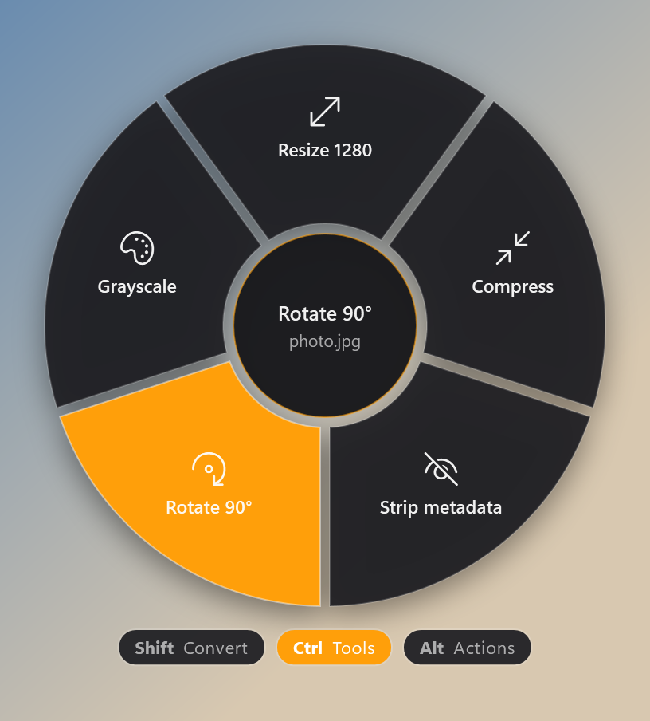
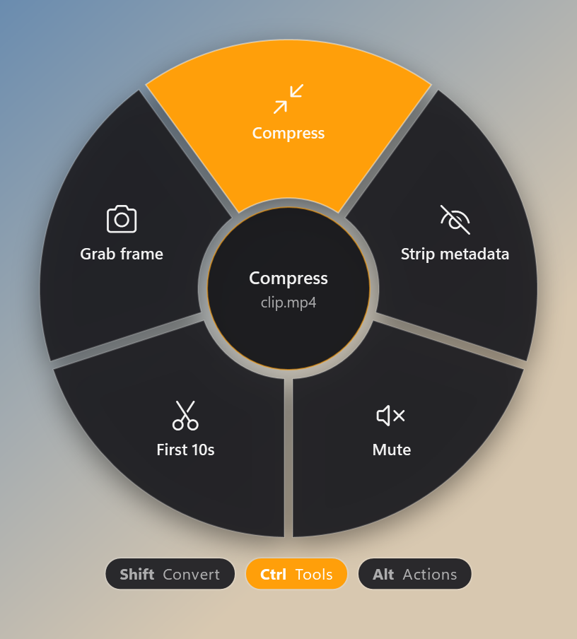
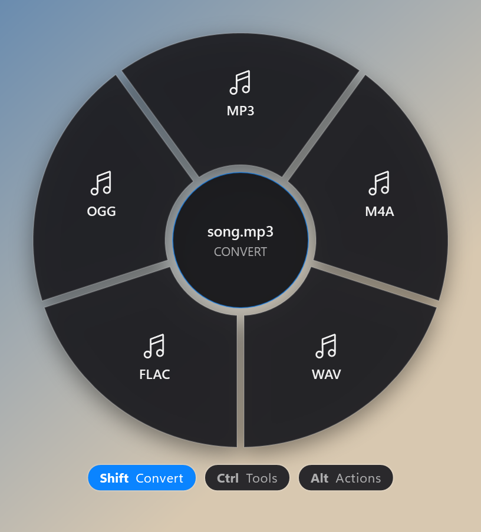
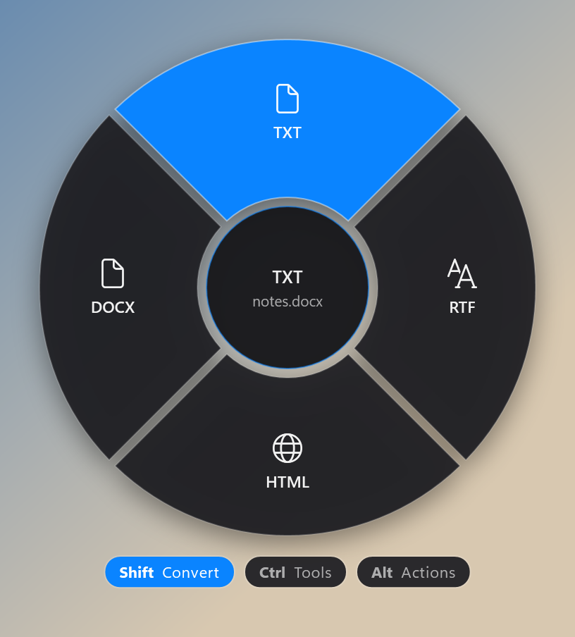
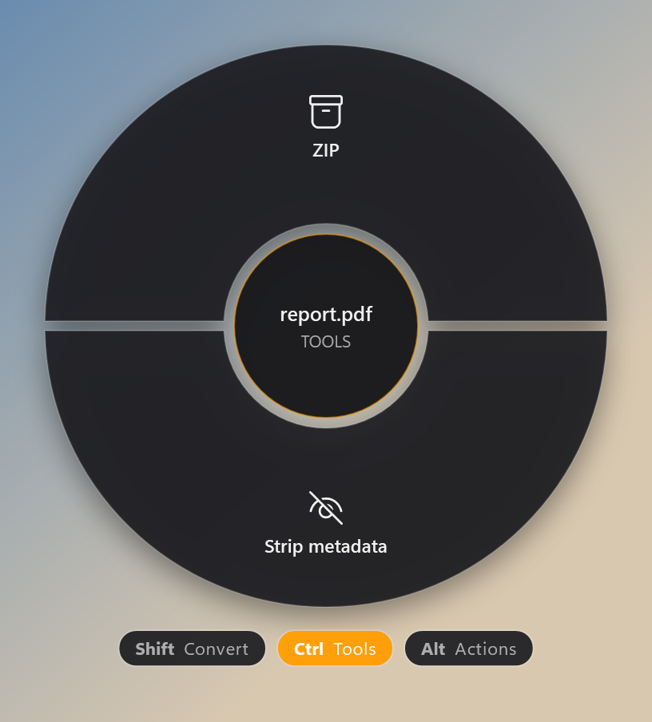
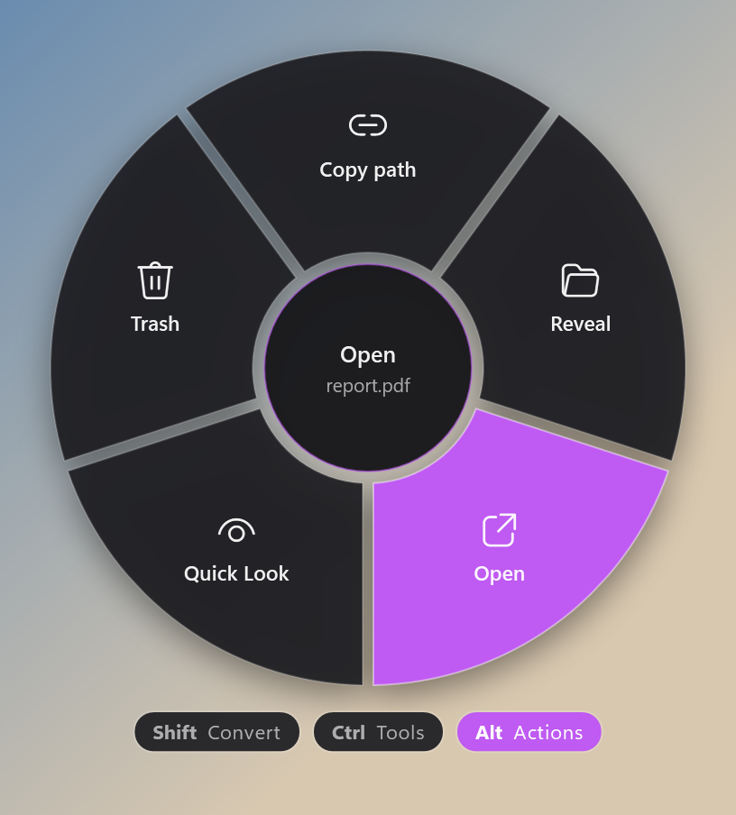

# ۳. مرجع کامل تیغه‌ها

همه‌ی خروجی‌ها توی `Downloads\FanDrop` ذخیره می‌شن و فایل اصلی دست نمی‌خوره.
ستون «نیاز» می‌گه اون تیغه به چیزی بیرون از ویندوز احتیاج داره یا نه ([آموزش ۴](04-requirements.md)).

---

## 🖼️ تصویر

`png jpg jpeg jfif jpe gif bmp tif tiff webp heic heif avif ico`

### Convert — <kbd>Shift</kbd>

| تیغه | خروجی | توضیح | نیاز |
|---|---|---|---|
| **PNG** | `name.png` | بدون افت کیفیت | — |
| **JPG** | `name.jpg` | کیفیت ۹۲٪؛ شفافیت روی زمینه‌ی سفید | — |
| **WEBP** | `name.webp` | کیفیت ۸۵٪؛ GIF متحرک، متحرک می‌مونه | ffmpeg |
| **HEIC** | `name.heic` | با کدک خود ویندوز | HEIF + HEVC Extensions |
| **TIFF** | `name.tiff` | فشرده‌سازی LZW بدون افت | — |
| **PDF** | `name.pdf` | عکس به‌صورت یه صفحه‌ی PDF | — |

### Tools — <kbd>Ctrl</kbd>

| تیغه | خروجی | توضیح |
|---|---|---|
| **Resize 1280** | `name (1280).ext` | ضلع بزرگ‌تر حداکثر ۱۲۸۰ پیکسل؛ تناسب حفظ می‌شه |
| **Compress** | `name (compressed).jpg` | JPG با کیفیت ۶۰٪ — برای فرستادن توی پیام‌رسان‌ها |
| **Strip metadata** | `name (clean).ext` | حذف EXIF (مکان GPS، مدل دوربین، تاریخ)؛ برای JPG بدون افت کیفیت |
| **Rotate 90°** | `name (rotated).ext` | چرخش ۹۰ درجه ساعت‌گرد |
| **Grayscale** | `name (gray).ext` | سیاه و سفید |

> HEIC/HEIF/AVIF توی Tools خروجی JPG می‌دن.

---

## 🎬 ویدیو — نیاز به ffmpeg

`mp4 mov m4v mkv avi webm wmv flv mpg mpeg 3gp ts mts m2ts ogv`

### Convert — <kbd>Shift</kbd>

| تیغه | خروجی | تنظیمات |
|---|---|---|
| **MP4** | `name.mp4` | H.264 (CRF 23) + AAC، آماده‌ی پخش آنلاین (faststart) |
| **MOV** | `name.mov` | H.264 + AAC |
| **GIF** | `name.gif` | ۱۲ فریم بر ثانیه، عرض ۴۸۰، پالت بهینه، بی‌صدا |
| **WEBM** | `name.webm` | VP9 + Opus |
| **MP3** | `name.mp3` | فقط صدا، VBR با کیفیت بالا |

### Tools — <kbd>Ctrl</kbd>

| تیغه | خروجی | توضیح |
|---|---|---|
| **Compress** | `name (compressed).mp4` | H.264 CRF 28 + صدای 128k — معمولاً حجم چند برابر کم می‌شه |
| **Strip metadata** | `name (clean).ext` | حذف متادیتا و چپترها بدون encode دوباره (سریع) |
| **Mute** | `name (muted).ext` | حذف صدا، تصویر بدون encode دوباره |
| **First 10s** | `name (10s).ext` | ۱۰ ثانیه‌ی اول، بدون encode دوباره |
| **Grab frame** | `name (frame).jpg` | یه فریم شاخص (نه لزوماً فریم اول) به‌صورت JPG |

---

## 🎵 صدا — نیاز به ffmpeg

`mp3 m4a wav flac ogg oga opus aac wma aiff aif caf alac amr`

### Convert — <kbd>Shift</kbd>

| تیغه | خروجی | تنظیمات |
|---|---|---|
| **MP3** | `name.mp3` | LAME VBR q2 |
| **M4A** | `name.m4a` | AAC 192k |
| **WAV** | `name.wav` | PCM |
| **FLAC** | `name.flac` | بدون افت |
| **OGG** | `name.ogg` | Opus 128k |

### Tools — <kbd>Ctrl</kbd>

| تیغه | خروجی | توضیح |
|---|---|---|
| **Strip metadata** | `name (clean).ext` | حذف تگ‌ها و کاور، بدون encode دوباره |
| **Normalize** | `name (normalized).ext` | یکسان‌سازی بلندی صدا (loudnorm، استاندارد EBU R128) |
| **First 30s** | `name (30s).ext` | ۳۰ ثانیه‌ی اول |
| **Mono** | `name (mono).ext` | تبدیل به تک‌کاناله |
| **Compress** | `name (compressed).mp3` | MP3 با بیت‌ریت 96k — برای ویس و پادکست |

---

## 📝 سند

`doc docx rtf txt html htm odt md pages`

### Convert — <kbd>Shift</kbd>

| تیغه | خروجی |
|---|---|
| **TXT** | `name.txt` (UTF-8) |
| **RTF** | `name.rtf` |
| **HTML** | `name.html` (با `dir="auto"` — فارسی درست نمایش داده می‌شه) |
| **DOCX** | `name.docx` |

ترتیب موتور تبدیل: **Microsoft Word** ← **LibreOffice** ← تبدیل داخلی.
با Word یا LibreOffice فرمت‌بندی (bold، جدول، …) حفظ می‌شه؛ تبدیل داخلی فقط متن و پاراگراف‌ها رو نگه می‌داره.

### Tools — <kbd>Ctrl</kbd>

| تیغه | نتیجه |
|---|---|
| **Copy text** | کل متن سند می‌ره توی کلیپ‌بورد |
| **Word count** | تعداد کلمه و کاراکتر توی نوتیفیکیشن؛ عدد کلمه‌ها هم کپی می‌شه |
| **ZIP** | `name.zip` |

---

## 📕 PDF

| حالت | تیغه | خروجی |
|---|---|---|
| Convert | **PNG** | هر صفحه یه فایل: `name - page 1.png`, `name - page 2.png`, … |
| Convert | **JPG** | هر صفحه یه فایل JPG |
| Tools | **ZIP** | `name.zip` |
| Tools | **Strip metadata** | `name (clean).pdf` — نیاز به `exiftool` |

PDF با موتور خود ویندوز رندر می‌شه؛ چیزی لازم نیست.

---

## 📦 بقیه‌ی فایل‌ها و پوشه‌ها

| تیغه | نتیجه |
|---|---|
| **ZIP** | یه فایل: `name.zip`؛ چند فایل/پوشه: `Archive.zip` (ساختار پوشه‌ها حفظ می‌شه) |
| **SHA-256** | هش فایل کپی می‌شه و توی نوتیفیکیشن هم نشون داده می‌شه. چند فایل: هر خط `hash  filename`. (روی پوشه کار نمی‌کنه) |

---

## 🟣 Actions — <kbd>Alt</kbd> (همه‌ی فایل‌ها)

| تیغه | کار |
|---|---|
| **Copy path** | مسیر کامل فایل(ها) کپی می‌شه؛ چند فایل = هر کدوم یه خط |
| **Reveal** | فایل توی Explorer باز و انتخاب می‌شه |
| **Open** | با برنامه‌ی پیش‌فرض باز می‌شه |
| **Quick Look** | پنجره‌ی پیش‌نمایش (عکس، ویدیو، صدا، PDF، متن) |
| **Trash** | انتقال به سطل بازیافت (قابل برگشت) |

---

[→ آموزش ۲](02-using-the-fan.md) · [فهرست](README.md) · [آموزش ۴: پیش‌نیازها ←](04-requirements.md)

