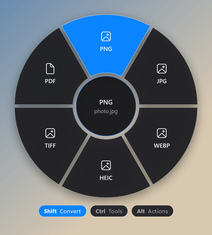

# 📚 آموزش‌های FanDrop برای ویندوز

به ترتیب بخون؛ اگه عجله داری، فقط ۱ و ۲ کافیه تا راه بیفتی.

| # | آموزش | چی یاد می‌گیری | زمان |
|---|---|---|---|
| ۱ | [نصب و اجرا](01-getting-started.md) | دانلود، اولین اجرا، آیکون tray، اجرای خودکار با ویندوز | ۳ دقیقه |
| ۲ | [اولین drag: کار با بادبزن](02-using-the-fan.md) | سه کلید، انتخاب تیغه، لغو، چند فایل با هم، فایل‌های مرورگر | ۵ دقیقه |
| ۳ | [مرجع کامل تیغه‌ها](03-reference.md) | هر تیغه دقیقاً چی‌کار می‌کنه و خروجیش چه اسمی داره | مرجع |
| ۴ | [نصب پیش‌نیازها](04-requirements.md) | ffmpeg، کدک HEIC، Word/LibreOffice، exiftool | ۵ دقیقه |
| ۵ | [سناریوهای کاربردی و ترفندها](05-recipes.md) | کارهای روزمره: عکس آیفون، GIF از ویدیو، زیپ پروژه، … | ۵ دقیقه |
| ۶ | [عیب‌یابی](06-troubleshooting.md) | بادبزن باز نمی‌شه؟ ffmpeg پیدا نمی‌شه؟ | مرجع |
| ۷ | [ساخت از سورس و توسعه](07-build-and-develop.md) | build.cmd، اجرای بدون UI، اضافه کردن تیغه‌ی جدید | ۱۰ دقیقه |

[← بازگشت به صفحه‌ی اصلی](../../README.fa.md)

